# Mirra - AI Before/After Previews for Aesthetic Clinics

Flutter app (iOS + Android) that lets aesthetic clinics, salons and med-spas show a client a realistic AI preview of a hairstyle, makeup look or filler / Botox result on the client's own photo before they book. It has a 3-day free trial and then a monthly subscription. Clients can use it in Hebrew or English, and the Hebrew UI is fully right-to-left.

## Demo

| iOS | Android |
|---|---|
| 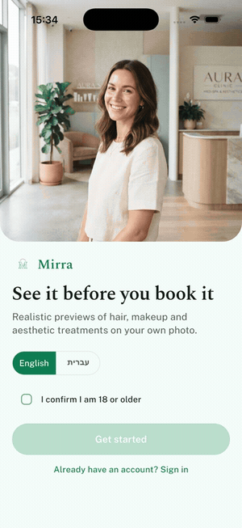 |  |

Same Flutter codebase running on the iPhone 17 Pro simulator and on a physical Pixel 7a.

## What it shows

- **Compliance first:** an 18+ age gate blocks sign up, and an informed-consent screen (4 explicit checkboxes) must be accepted before any photo is processed. Generation is route-guarded on consent.
- **AI simulation labelling:** every generated image carries a permanent "AI simulation" badge. Every result also shows the "AI-generated simulation, not a guaranteed medical outcome" disclaimer.
- **Three simulation types:** hairstyle + color, makeup look + intensity, and filler / Botox by treatment area. Filler is measured in ml (lips, cheeks, jawline, under-eye) and Botox in units (forehead lines).
- **Before/after compare:** a draggable split slider over the original and simulated photo.
- **Generative image pipeline:** `GeminiSimulationService` calls Gemini 2.5 Flash Image ("Nano Banana") with an identity-preserving, edit-only prompt. `MockSimulationService` returns bundled results so the demo runs offline.
- **Subscription:** the trial starts on sign up. The paywall appears when the trial ends, and the monthly plan is sold through the official `in_app_purchase` plugin (StoreKit 2 / Google Play Billing, no proprietary SDK). The cancel flow keeps access until the end of the paid period.
- **Privacy center:** shows photos stored (with 30-day auto-delete), lets the client delete one preview or delete all data, and controls whether the clinic can see shared previews.
- **Clinic admin view:** today's sessions, booking conversion, and per-client history that shows consent status and which previews the client shared or kept private.
- **Hebrew + English:** switching language flips the whole app to RTL (tabs, chevrons, layout).
- **Billing tests:** 12 unit tests cover trial, purchase, renewal, cancellation and the monthly filler quota, and 2 widget tests cover the age gate and the full flow.

## Screenshots

| Welcome + 18+ gate | Sign up (trial) | Consent | Studio |
|---|---|---|---|
|  | 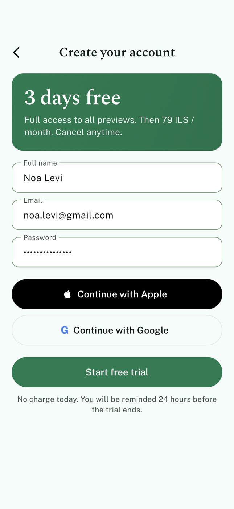 | 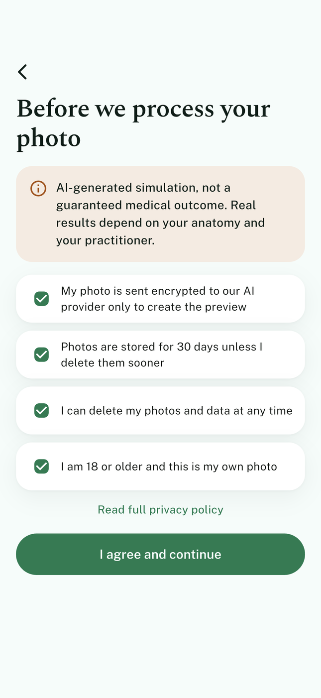 | 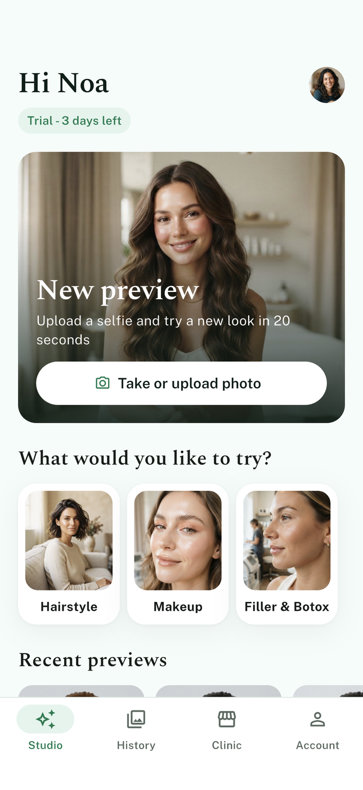 |

| Photo guide | Filler & Botox | Generating | Before / after |
|---|---|---|---|
| 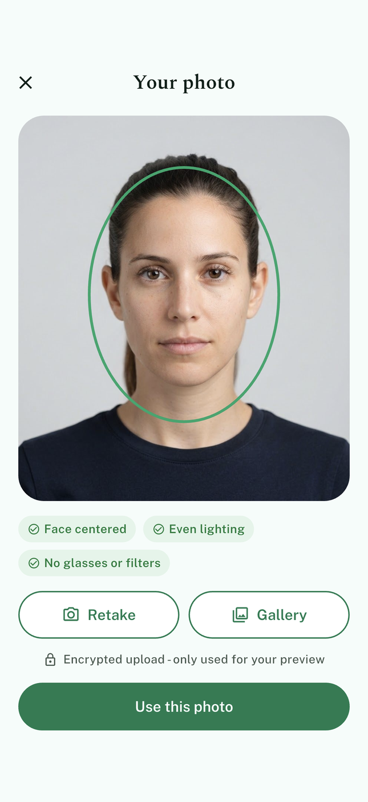 | 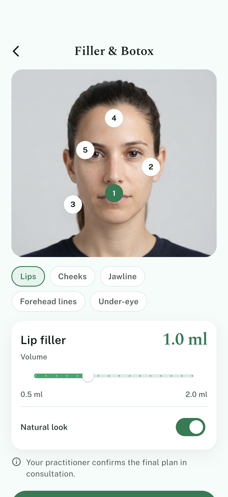 | 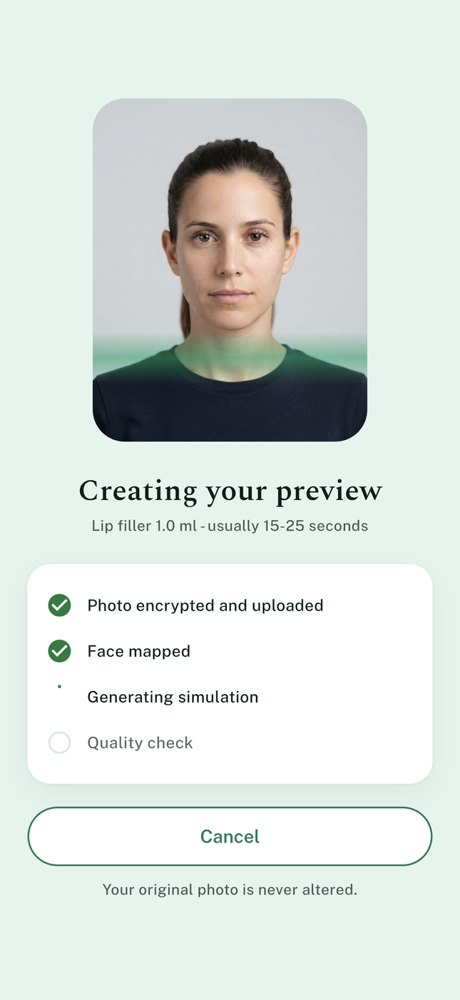 | 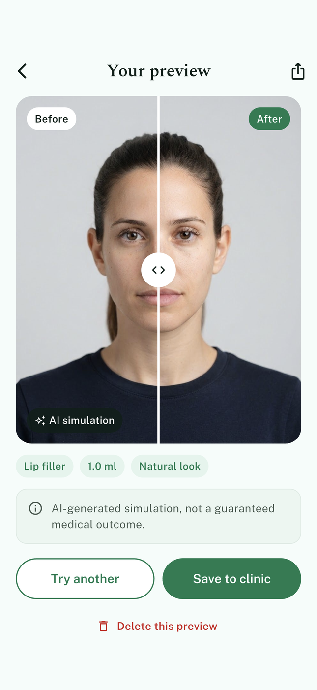 |

| Hairstyle | History | Clinic today | Client detail |
|---|---|---|---|
| 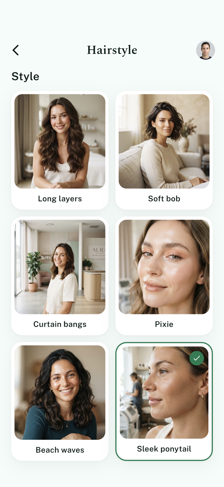 | 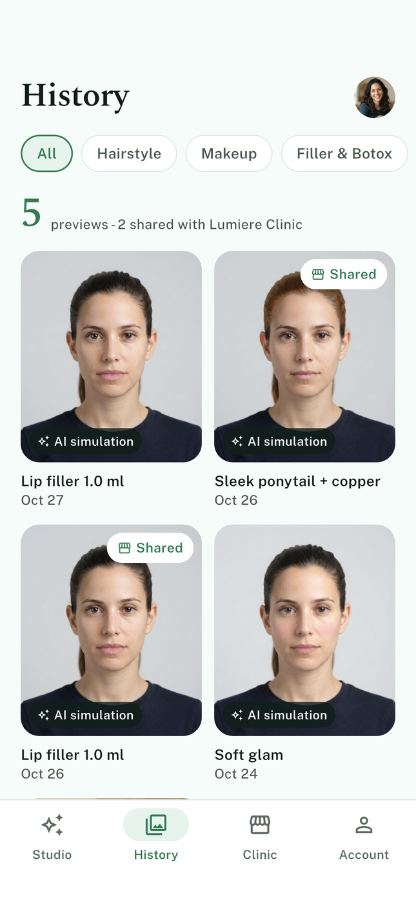 | 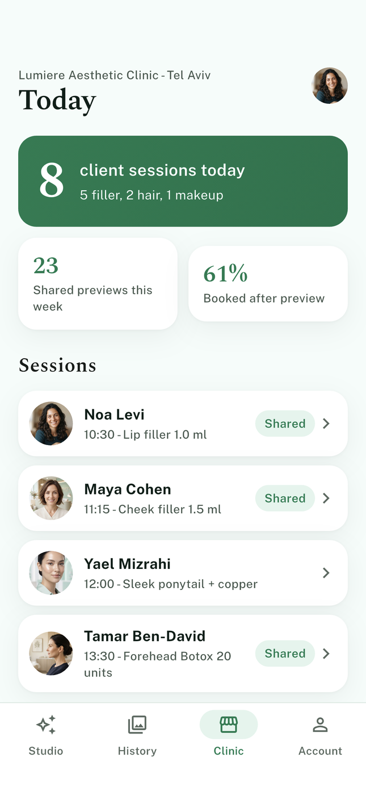 | 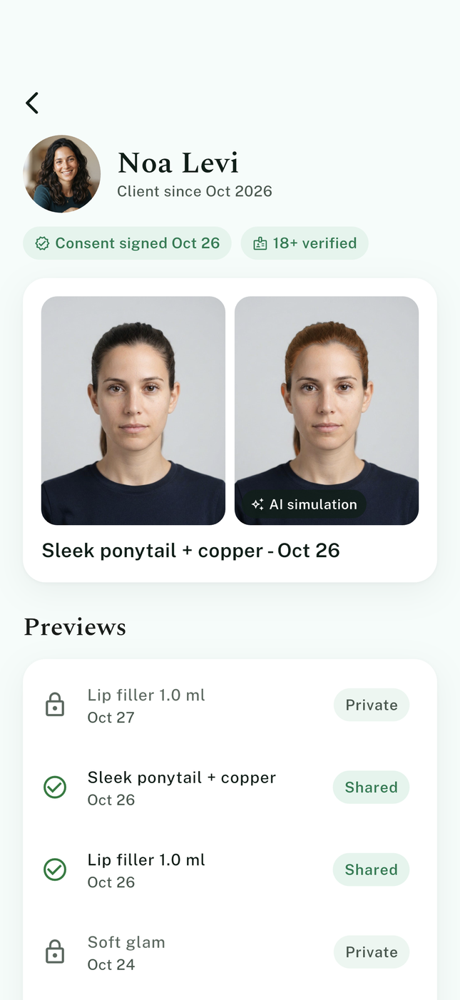 |

| Paywall | Subscription + cancel | Privacy & data | Hebrew (RTL) |
|---|---|---|---|
| 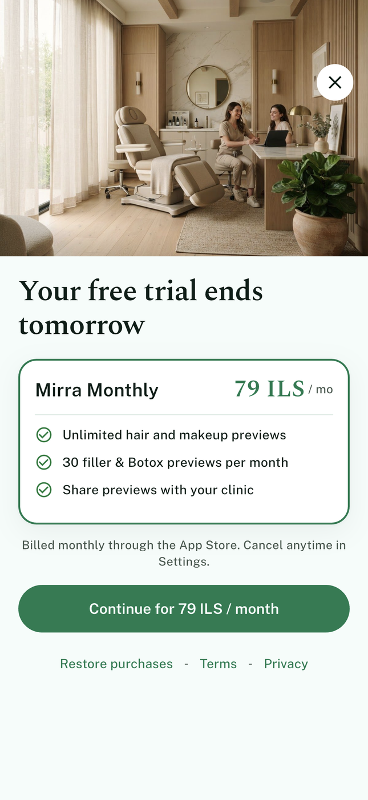 | 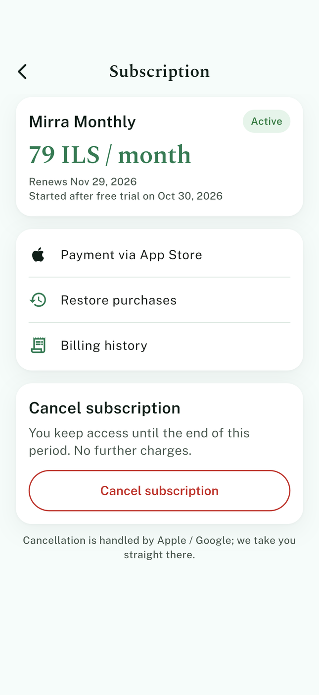 | 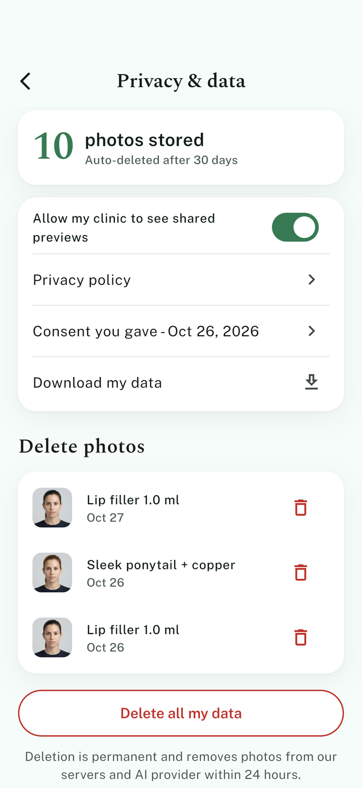 | 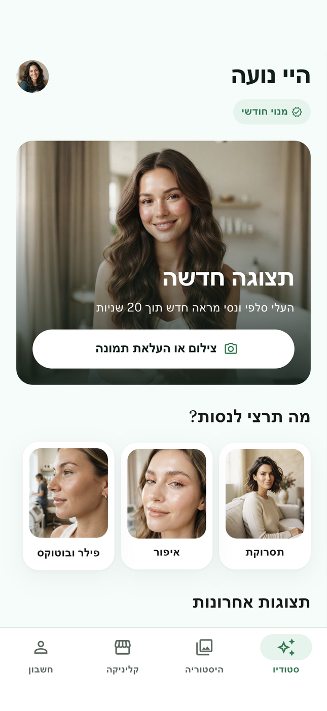 |

## Flow

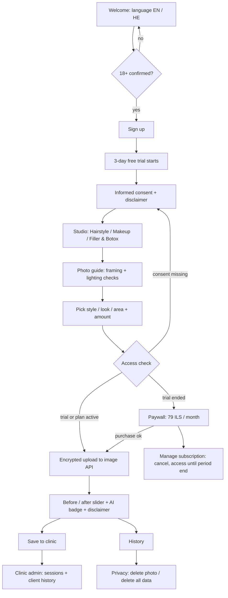

## Architecture

```
lib/
  main.dart                  MaterialApp.router, EN/HE locales, RTL via flutter_localizations
  router.dart                go_router + StatefulShellRoute (Studio, History, Clinic, Account)
  theme.dart                 design tokens from design/DESIGN.md (Public Sans + Spectral)
  l10n/strings.dart          EN / HE string table
  models/models.dart         SimulationRequest (+ prompt builder), Preview, ClinicSession
  billing/subscription.dart  pure trial / renew / cancel / quota rules (unit-tested)
  billing/billing_service.dart  BillingService: StoreBillingService (in_app_purchase) + Mock
  services/simulation_service.dart  Gemini image edit + offline mock
  state/providers.dart       Riverpod Notifiers: onboarding gates, subscription, previews, generation
  screens/                   onboarding, studio, result/history, account (paywall, subscription, privacy), clinic
  widgets/                   buttons, cards, AI badge, disclaimer, before/after slider
design/                      design screens (HTML + PNG), DESIGN.md, brief.json, logo
test/                        subscription_test.dart (billing), flow_test.dart (age gate + end-to-end)
integration_test/            screenshot + demo walkthrough on device
```

- **State:** Riverpod 3 `Notifier`s. Compliance gates (age, consent) and the subscription are separate providers, and `goGenerate()` checks both before any photo is sent.
- **Billing:** `Subscription` is a plain immutable value with `startTrial / purchase / cancel / tick`. If a client subscribes during the trial, billing starts when the trial ends. A cancelled plan keeps access until `periodEndsAt`. Receipt validation belongs on the server (App Store Server API / Play Developer API).
- **Image API:** in production the Gemini call runs on a backend function so the API key never ships in the app. The photo goes over TLS to a short-lived signed URL and is deleted after 30 days or when the client asks.
- **No locked dependencies:** Flutter, Riverpod, go_router, http and the official in_app_purchase plugin.

## Run

```sh
flutter pub get
flutter run                                  # offline mock results
flutter run --dart-define=GEMINI_API_KEY=... # live Gemini image edits
flutter test                                 # billing + flow tests
```

The Account tab has a "Advance clock +1 day" demo control, so you can see the trial expire, the paywall, renewal and cancellation without waiting.

## Stack

Flutter 3.44, Dart 3.12, flutter_riverpod 3, go_router 17, in_app_purchase 3, http, flutter_localizations.
